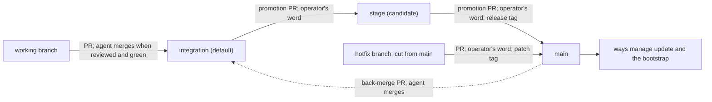

# ADR-615: Changes land on integration, a release candidate is evaluated on stage, and main moves only by promotion

## Summary

- **Decided:** agent-ways keeps three long-lived branches. Every working branch merges into `integration`, which becomes the GitHub default branch. `stage` holds a release candidate taken from integration and evaluated on this host. `main` holds what passed evaluation: `ways manage update` follows it, the bootstrap installs it, and release tags go on it. A change moves up a tier only through a promotion pull request, merged by regular merge with green CI. The agent opens promotion pull requests, and each one merges on the operator's word. The agent merges reviewed, green pull requests into integration without asking. A release is cut when a promotion to main carries a change to a binary. This record also moves ADR-613's definition of a done card from main to integration.
- **Trades away:** Every release takes two promotion pull requests and the operator's word on each. A reviewed change reaches users at the next promotion, not at its merge. A fix found while evaluating stage goes back through integration, and the candidate is evaluated again. A hotfix needs a back-merge into integration. The GitHub front page shows integration, so the bootstrap names main explicitly.
- **One-way?** No. Reversible: the default-branch setting, the workflow triggers, the scripts and the way text change back in one session. Users' installs follow main before and after, so nothing on their machines migrates.
- **Probes:** *Not confident (hotfix):* A fix that cannot wait for the next promotion goes on a branch cut from main, merges into main on your word with its own patch release, and then main is merged back into integration. Is that the hotfix path you want? Yes or no. *Confident (content-only promotion):* A promotion to main that changes only ways, skills or docs, and no binary, goes out without a release. Yes or no.
- **Inversion:** At one end, every reviewed merge goes straight to the branch users update from, as today. At the other, users install only tagged releases and no branch reaches them. This sits between: work lands freely on integration, and the branch users follow moves only when the operator promotes an evaluated candidate.

## Context

Today every reviewed pull request merges into main, and main does three jobs. Work lands there, `ways manage update` pulls it onto every user's install, and release tags go on it. A merge reaches users on their next update before anyone has run the merged batch on a live install. `make dev-install` and the live fixture (ADR-508) evaluate one branch on this host, and nothing holds the combined batch still while it is evaluated.

Releases also lag main. ADR-150 cuts a release when a user-affecting change to a binary lands, so main usually runs some commits past the latest tag, and the update guard has to decide whether a downloaded release binary is older than the source it is installed beside.

Several parts of the repository assume one branch. `scripts/release.sh` bumps and tags only from main. The workflows run on push to main. The bootstrap clones whatever GitHub marks as default. The GitHub ruleset protects only the default branch. The operator asked to keep users on main and to move work through integration and stage first.

## Decision

The flow below shows each branch, the pull request that moves a change into it, and who merges it.

### 1. Branch roles

- **integration** receives every working branch's pull request. It is the GitHub default branch, so a new branch is cut from it and a new pull request targets it.
- **stage** holds the release candidate: a copy of integration at the moment it was promoted. The candidate is evaluated on this host with `make dev-install`, and with the live fixture at the tier the project-health way names for what changed. An install can run the candidate with `ways manage update --ref stage`.
- **main** holds what has passed evaluation. `ways manage update` follows it, the bootstrap installs it, and release tags point at its commits. main moves only by a promotion from stage, or by the hotfix path in item 6.

### 2. Promotion

- A promotion is a pull request from integration to stage, or from stage to main. It merges by regular merge once its CI is green.
- The agent opens both kinds of promotion pull request when a batch is ready. Each one merges on the operator's word.
- A fix found while evaluating stage goes into integration through an ordinary pull request, and integration is promoted to stage again. The new candidate also carries whatever else merged into integration in the meantime, so it is evaluated again.
- Nobody commits or pushes directly to stage or main. The only pull request into main whose head is not stage is a hotfix (item 6).

### 3. Releases and what update follows

- `ways manage update` keeps following main through the app checkout's upstream. Existing installs already track origin/main, so their behaviour does not change.
- When a batch carries a change to a component's binary source, the agent opens the version bump pull request into integration before promoting it to stage. The candidate on stage then carries the version it ships under.
- After the stage-to-main promotion merges, the agent tags the merge commit on main with `make publish-release`. The operator's word for that promotion is the ask that covers the release. The tag push builds every platform and publishes the GitHub Release, as today.
- A promotion that changes no binary source cuts no release. Its ways, skills and docs reach users through the update's pull of main. Probe 2 checks this reading of the operator's choice.

### 4. The default branch

integration is the GitHub default branch. Claude Code tells the agent to branch first when it is on the default branch. The topic-branch way and the merge way find the default branch with `git symbolic-ref refs/remotes/origin/HEAD` or `gh repo view`, and `gh pr create` without `--base` targets it. With integration as the default, each of these does the right thing without project-specific wording, and so does a contributor's pull request opened in the GitHub interface. The alternative, main as default with every pull request retargeted to integration, needs a `--base` on every agent and contributor pull request and leaves every default-branch lookup pointing at the branch users install.

Two things key on the default branch and must not follow it to integration. The bootstrap names main in its clone. The ruleset names its three branches instead of `~DEFAULT_BRANCH`.

### 5. Who merges what

- The agent merges a reviewed pull request with green CI into integration without asking. The operator's standing grant already covers it.
- Promotion pull requests into stage and main, hotfix pull requests into main, and releases wait for the operator's word. The standing grant as written would also cover a promotion, so this project's `.claude/CLAUDE.md` narrows it, as the grant allows.
- ADR-611 stands. stage and main are protected branches and so consequential branches. integration is the default branch and so also consequential under ADR-611's definition, and the standing grant is the source that covers merging into it.

### 6. Hotfixes

A fix that cannot wait for the next promotion goes on a `hotfix/<topic>` branch cut from main. The branch carries the fix and the patch version bump. The agent opens a pull request into main; it merges on the operator's word once CI is green, and the agent tags the merge commit as a patch release. The agent then opens a pull request from main into integration and merges it under the integration grant, and the next promotion carries the fix to stage. Probe 1 checks this path.

### 7. CI per tier

- Push triggers move from main to integration. A push to stage or main runs no build, because the promotion pull request that produced it already ran CI on the same tree, and a release tag push builds every platform before it publishes.
- Pull request triggers stay on every base. The light workflows (test, clippy, portability, reuse, adr-tool, cite) run on promotion pull requests.
- build-<component>.yml skips a pull request whose head is integration or stage, as it skips a `release/` head today. Those trees were built on the push to integration. A hotfix pull request builds, because its tree was never built.

### 8. A done card (amends ADR-613 item 1)

A card is done when its change merges into integration, its issue is closed, and its owned findings are fixed. GitHub closes an issue named by a closing keyword when the pull request merges into the default branch, which is integration. Promotions carry finished cards in batches and are release work, not card work. Counting a card open until it reaches main would hold every card in a batch open across the operator's promotion pace.

### Implementation work

Each item is a file or a setting. None of them changes before this record is accepted.

1. **GitHub settings:** create `integration` and `stage` from main; set the default branch to integration; change ruleset 14941028 "Default Protect" from `~DEFAULT_BRANCH` to `refs/heads/main`, `refs/heads/stage` and `refs/heads/integration`; add a pull request requirement with no required approvals on stage and main. No required status check is added, because the path-filtered workflows do not report on every pull request and a required check that never reports blocks the merge. The agent checks `gh pr checks` before it merges or offers a merge.
2. **`.github/workflows/test.yml`, `clippy.yml`, `portability.yml`, `reuse.yml`, `adr-tool.yml` and every `build-<component>.yml`:** change the push trigger from `branches: [main]` to `branches: [integration]`; leave the pull request triggers unchanged. In each `build-<component>.yml`, extend the job's `if:` that skips a `release/` head to skip a head of `integration` or `stage`. clippy's weekly schedule then runs on integration.
3. **`scripts/release.sh`:** `bump` runs from integration in sync with origin/integration and opens its pull request with `--base integration`; a hotfix form runs from a `hotfix/` branch cut from main and opens against main; `tag` keeps its main guards; the messages that say "after that PR merges to main" name the promotion. **`Makefile`** `cut-release` passes the hotfix form through; `publish-release` is unchanged.
4. **`scripts/install.sh`:** `fetch_verified` clones with `--branch main` when no revision is given.
5. **A promotion helper:** `scripts/promote.sh`, run as `make promote TO=stage` or `make promote TO=main`, opens the promotion pull request with `gh pr create --base <to> --head <from>` and lists the pull requests the promotion carries in its body.
6. **`skills/merge/SKILL.md`, `hooks/ways/softwaredev/delivery/merge/merge.md` and `hooks/ways/softwaredev/delivery/github/github.md`:** replace the hard-coded `main` in the merge target and the cleanup (`git log main..HEAD`, `git checkout main && git pull`) with the default branch. These ship to every project, so they read the default branch and do not describe this project's three tiers. **`skills/release/SKILL.md`:** replace `git push origin main --tags` and "the work should already be on main" with the branch the project tags.
7. **`.claude/ways/meta/project-health/project-health.md`, Release Mechanics:** the bump into integration, the two promotions, the evaluation on stage, the tag on main, the hotfix path and the CI per tier.
8. **`.claude/CLAUDE.md`:** steps 3 and 4 of the build cadence name integration as the pull request base and add the promotions. Add the grant line: "In this repository, merge a reviewed pull request with green CI into integration without asking. Promotion pull requests into stage and main, hotfix pull requests into main, and releases wait for my ask."
9. **`CONTRIBUTING.md`:** pull requests target integration; the weekly clippy canary runs on integration.
10. **ADR-613 on acceptance:** a dated note at item 1 and in its Summary citing this record, with the text it replaces.
11. **No change needed:** `tools/ways-cli/src/cmd/update/` (follows `@{u}`, origin/main), `hooks/check-config-updates.sh` (compares with origin/main), the curl one-liner in `README.md` and `docs/install-guide.md` (fetches `install.sh` from main), `.github/workflows/live-fixture.yml` (clones main) and `.github/workflows/pages.yml` (deploys on tags).

## Consequences

### Positive

- main and every user's install move only when the operator promotes a candidate that was evaluated on this host.
- When a promotion to main carries a binary change, its release is tagged on that commit, so main and the latest release share binary source far more often than today, and the update downloads the release binary instead of building from source.
- Reviewed work merges into integration without waiting for the operator, and stage holds a fixed candidate while integration keeps taking work.

### Negative

- Each release takes two promotion pull requests and the operator's word on each, and a reviewed change reaches users later than today.
- The light workflows run again on each promotion pull request. With the build skip in item 7, a binary change builds four platforms on its own pull request, on the push to integration and on the release tag, the same three builds it gets today. Without the skip, each release adds two more four-platform builds.
- A fix found during stage evaluation goes around integration again, and the candidate it produces carries everything else merged since, so it is evaluated again.
- Regular-merge promotions put merge commits on stage and main that integration never receives, so GitHub shows those branches as ahead of integration while their files match. Files differ only after a hotfix. A missed back-merge leaves main with a change integration lacks, and the next promotion to main may conflict on those lines.
- An issue closes when its pull request merges into integration, before users have the change. The release notes and the tag say when it shipped.
- A promotion that changes no binary leaves main ahead of its latest tag in content only. Whether the update keeps the release binary in that state depends on the update guard accepting a release that is behind main only in files no binary is built from.

### Neutral

- A fresh clone and every agent session start from integration.
- Users' installs track origin/main before and after the change, and nothing on their machines migrates.

## Alternatives Considered

- **Two tiers, integration to main.** Offered to the operator and declined. Evaluating the batch would mean stopping merges into integration, or evaluating a branch that keeps moving. stage holds a fixed candidate while integration keeps taking work.
- **Automatic promotion on green CI.** Offered to the operator and declined. CI does not run the host evaluation (`make dev-install`, and the live fixture, which runs locally under ADR-508), so a green run would move main and every user's install without it. A release also needs the operator's ask and a tag signed with the operator's key.
- **main stays the GitHub default and pull requests target integration by `--base`.** Declined. Every default-branch lookup in Claude Code, the ways and `gh` would cut branches from main and merge into main, and every contributor pull request would need retargeting. Pinning the bootstrap to main is one change.
- **Users follow release tags instead of a branch.** Declined. The operator asked to follow main, and update keeps the branch model ADR-142 set.
- **Version bumps committed straight to stage.** Declined. A commit that exists only on stage has to be merged back into integration, and the bump into integration avoids it.
