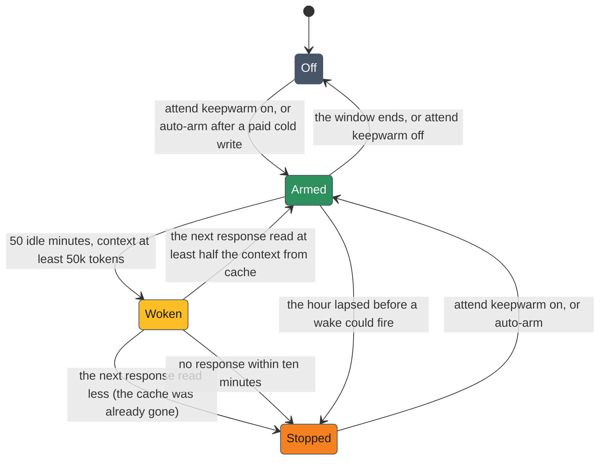

# Keepwarm — holding the prompt cache across idle time

Claude Code caches a session's prompt on the one-hour cache tier. Each request reads the cached prefix and restarts the hour. A request that arrives after the hour has lapsed writes the whole prefix again at the cache-write rate: on a 200k-token session that is dollars, against cents for a warm turn. Keepwarm, while armed, wakes an idle session once at 50 idle minutes so the next request reads the cache instead of rewriting it.

The attend mod drives the wake ([`mod.md`](mod.md)). On its poll it runs `attend keepwarm check`, which judges the session and prints a `keepwarm:` line when a wake is due, and the mod submits that line as a turn. The turn runs over the full context, and its request reads the cache and restarts the hour. A session without the mod gets no wake.

## When to arm it

Arm it before leaving a large session idle that you will come back to: lunch, a meeting, a long build in another window. It is not worth arming for a small context or for a session you will not return to. It is off by default, because every wake costs a cache read on an API key and an unknown share of the rate limit on a subscription.

```bash
attend keepwarm on          # arm for 6 hours
attend keepwarm on 90m      # arm for a window: 6h, 90m, 2h30m
attend keepwarm off         # disarm
attend keepwarm status      # the card below; also what bare `attend keepwarm` prints
```

These verbs act on the Claude session that runs them, so run them from inside the session (the agent's Bash tool, or `!` in the prompt). Outside a session they print `keepwarm: no Claude session owns this process, nothing to warm` and exit 1. An armed window wakes a listening session only; where autocompact is off, the mod keeps the session warm with no arming at all (the continuity policy's keepalives, below).

**Auto-arm.** When `attend keepwarm check` sees a paid cold write (below) on a context of at least 50k tokens, it arms three hours on its own if no window already covers them. A session that has paid one rewrite has shown it comes back, and the second rewrite is not paid that day.

## The continuity policy

The continuity policy is what the attend mod does to keep a session's work going while the operator is away. It has two triggers that share one wrap: idle time drives its keepalive path, and context fill drives its relay path. It runs in an interactive Claude Code session that runs the attend mod, whether the session is listening or dormant, and never in a `claude -p` run or an SDK session. After a judge's `stop` at a work boundary, the [armed exit](#the-armed-exit) decides the idle ticks in place of the keepalive count.

### Keepalive: the idle path

In a session with autocompact off, nothing needs arming: the mod keeps an idle session warm for a stretch the operator bounds, then asks the agent to wrap and lets the cache lapse. In relay mode the idle path runs whatever the autocompact switch says, and a compaction and a resume follow its wrap ([relay](#relay-the-context-fill-path)).

- **The clock.** Every main-loop request restarts it, whatever started the turn: an operator prompt, an attend delivery, a keepalive, a background agent's notice. A keepalive is due at the newest request's time plus its cache tier's TTL, less `margin_minutes` (default 10, so 50 minutes on the hour tier). Nothing is due while a main-loop turn runs, on the five-minute tier, or under 50k tokens of context. At a due point whose cache has already lapsed (the host slept), nothing is sent and the policy stops until the operator's next prompt.
- **The bound.** attend counts the keepalives sent since the operator's last prompt. At each due point: under `max_keepalives` (default 8) and inside a window, the mod submits the `keepwarm:` line and the count goes up; otherwise, when a wrap can run (below), it submits one `wrap:` turn; otherwise the policy stops. After a stop nothing more is sent until the operator prompts, and the cache lapses about an hour later. With the defaults the keepalives land 50, 100 and on to 400 minutes after the last turn, the wrap at 450 minutes.
- **After the wrap.** These rules hold in handoff mode; in relay mode a compaction and a resume follow every wrap instead. With `after_wrap_keepalives` at 0 (the default), nothing more follows the wrap: the cache lapses, or with `after_wrap: compact` the mod compacts once the wrap has answered. Set to m, the keepalives go on m more times after the wrap, still inside the windows, so an operator back within that stretch finds the whole conversation warm and the handoff already written. At the next due point after them, or the first outside the windows, `after_wrap` applies: `lapse` sends nothing more, and `compact` has attend ask the mod for one compaction with the focus of the wrap's closing `/compact` line, which the mod reported with `attend keepwarm wrapped --focus`. A wrap that left no reply compacts nothing. The mod reports the compaction with `attend keepwarm compacted` (`--failed <why>` when it did not run), and nothing more follows until the operator's next prompt. With `max_keepalives: 4`, `after_wrap_keepalives: 3` and `after_wrap: compact`, a session left alone wraps 4 h 10 min after its last turn and compacts at 7 h 30 min, 3 h 20 min after the wrap, so the operator comes back to a small context.
- **The wrap skill.** `wrap_skill` names the skill the wrap turn asks for, with its arguments: `wrap stay`, the shipped wrap skill, by default. The wrap and the compaction run only when the session lists that skill: the mod passes the skills from the session's usage breakdown with `--skills`, and `--skills-partial` when the listing's token budget cut it short, in which case a missing skill is not held against the wrap. Empty, a skill the session does not have, a value refused (a name of anything but letters, digits and `: _ - .`, or more than two argument words of 16 characters, or one opening with `-`), or a listing the mod could not read (`--skills-unread`) leave them off, and the keepalives stop at `max_keepalives`; the card says why. The check bounds the field to a skill invocation; it is no defence against a project whose checked-in instructions are hostile. A host that passes none of the flags, a mod from before them, is not held to a listing and gets no keepalives after the wrap.
- **What resets it.** A prompt the operator typed (the terminal, Remote Control, an SDK host's turn, the owner's Slack ping): the mod runs `attend keepwarm reset`. While autocompact is on the mod holds the prompt instead and sends it with `reset --at` when the gate first reads off. An attend delivery restarts the clock and leaves the count, since attend cannot tell a message the operator typed in attend-chat from a peer's.
- **The windows.** `windows` lists entries `<days> <HH:MM>-<HH:MM>`: `daily`, one day (`Sat`) or a range (`Mon-Fri`, `Fri-Mon` wrapping the week). `24:00` closes a day; an end before its start crosses midnight and belongs to the start's day. They are read in `timezone`, an IANA name, or the host's zone when it is empty. They gate keepalives only: outside them the next due point sends the wrap. The default `daily 00:00-24:00` leaves the count as the only bound; an empty list is never inside. An entry that does not parse is dropped and the status card names it.
- **The wrap.** The turn's first line gives the reason (`wrap: 7h30m since the operator's last prompt and 8 keepalives, the most this session allows.`), and its body asks the agent to run `wrap_skill` (the wrap skill with `stay` by default), ask nothing, land nothing and start nothing, and says what follows: nothing, the keepalives after the wrap, or the compaction. `wrap` routes the final reply: `transcript` (the default) leaves it there; `file` has the mod write it to `wrap_file`; `send` has the mod send it over attend to `wrap_to` (empty for the operator's own member id, a session name, a project path or `#channel`) as one message opening with a `handoff:` line, written to `wrap_file` instead when attend refuses the send. `wrap_file` must name `{session}` in its file name (so `{state}/wrap/{session}/notes.md` falls back) and resolve under `{state}/wrap/` with no `.` or `..` and through no symlink, since a project's checked-in config can set it; anything else goes to `{state}/wrap/<session>.md`, and the card names the refusal. `wrap_to` `#open` is refused, since it reaches every listening session, and the reply goes to the operator. Only the turn the wrap's own text started is routed, and its reply is the answer of the turn's first step that ended it, so a peer message or a notification that continues the turn is not taken for the handoff. attend writes the file (`attend keepwarm wrapped file --path <file> --save`, the reply on stdin), checking the path again and renaming a temp file over it. A wrap turn that ends other than with an answer is written nowhere, and one that never starts, or never answers before the cache lapses, is recorded unfinished. `after_wrap: compact` compacts the conversation with the focus of the wrap's closing `/compact` line, once the wrap has answered or after `after_wrap_keepalives` more keepalives.
- **Armed windows.** `attend keepwarm on` overrides the count and the windows while its window is open, so no wrap is sent; `attend keepwarm off` stops the policy until the operator's next prompt. A paid cold write arms nothing where the policy runs.
- **Autocompact.** The mod reads `isAutoCompactEnabled` from the session's usage breakdown before each check and again just before it submits a keepalive or a wrap, falling back to `autoCompactEnabled` in the merged settings, where only an explicit `false` is off. A gate it cannot read counts as on. With relay off and autocompact on, the idle path does not run: a listening session keeps the armed windows of `attend keepwarm on`, and a dormant one runs nothing, not even at a prompt. With relay on, the idle path runs whatever the autocompact switch says.
- **Failing closed.** Only an explicit `keepalive: true` runs the idle path. Settings ways cannot answer leave it off, and the card says `off: the mods.attend settings could not be read`. Keepwarm's own three-hour arm after a paid cold write is marked in the arm file, and the policy ignores it. Two processes on one session id take turns under a lock, so the wrap is decided once.

### Relay: the context fill path

`relay` picks what follows a wrap. With `off`, handoff mode and the default, a wrap ends with a `/compact <focus>` line for the operator, and the idle path's wrap is followed by `after_wrap`. With `on`, relay mode, the mod follows every wrap with a compaction on the wrap's handoff and a turn that resumes the work, so a session carries its task list across several context windows while the operator is away. Relay starts turns nobody watches and spends tokens, which is why it is off unless set.

- **The setting.** `relay` resolves through the project's `.claude/ways.yaml`, then the user config, then the default `off`, so a project set to `off` stays off when the user sets `on`. It is its own setting and does not follow Claude Code's autocompact switch: an unset `relay` is `off` whatever autocompact says. `ways settings get mods.attend.continuity.relay --project <dir>` prints the effective value. attend reads it when it judges a wrap, and the wrap skill reads it at its first step, so a change applies from the next wrap.
- **The fill trigger.** At each main-loop turn's end, the mod reads the context's size from Claude Code's `session.measure` event and passes it to attend's check. When the context reaches `relay_at_pct` of the model's window (75 by default), the session drains: attend's check returns a drain, and the mod submits one `drain:` turn that tells the agent to start nothing new, finish the work in flight, collect its agents' reports, and run the wrap skill at the next boundary, where a piece of work lands. When the context reaches `hard_at_pct` (85 by default), attend's check returns a wrap, and the mod submits one `wrap:` turn, so the agent wraps mid-work. With Claude Code's autocompact on, attend lowers the hard line to five points of the window under Claude Code's own compaction threshold when that is lower, so the relay's wrap comes first. The mod reads that threshold from `$.session.usage`. The drain point never sits above the hard line, and a `hard_at_pct` not above `relay_at_pct` leaves no drain. One drain and one fill wrap run per context window. The drain lasts until the conversation is compacted or the context falls under the drain point, and an operator prompt does not end it. No fill wrap is judged again until the conversation has been compacted or the operator has prompted. `session.measure` fires only at a turn's end, so a single long turn that crosses Claude Code's threshold partway through is compacted by Claude Code first; the PreCompact hook (below) directs that compaction, and no resume follows it.
- **The other wraps.** In relay mode the idle path's wrap and a `/wrap` the operator types or the agent invokes end the same way as a fill wrap, and `after_wrap` and `after_wrap_keepalives` do not apply. The keepalives before the idle wrap still run, so a project that wants a faster relay after idling lowers `max_keepalives`. A `/wrap` the operator types is an operator prompt and resets the relay count. `/wrap handoff` forces handoff mode for that one wrap, which stops a relay by hand.
- **The wrap turn.** The mod's wrap turn names relay mode and a wrap id, an id unique to this one wrap such as `20261126T214012Z-3f9a1c2e`. A fill wrap's turn reads:

  ```
  wrap: context at 86% (860k of 1M), past the hard line of 85%.
  The operator is away. Run the wrap skill with the argument stay: square the task list and write the continuation prompt. Ask no questions, land nothing and start no new work. This wrap is in relay mode with wrap id <id>: write wrap=<id> on the handoff's first line and end your reply with the relay marker. Once you answer, the mod compacts the conversation with the handoff and starts a turn that resumes the work.
  ```

  An idle wrap's turn opens with the idle reason line and has the same body.
- **The handoff and the marker.** In relay mode the wrap skill lands nothing and asks nothing. It writes `.claude/handoff.wrap.md` at the repository root with `<YYYY-MM-DD> <short HEAD> wrap=<wrap id>` on its first line; for a `/wrap` it makes the id from the UTC time and the session id. It ends its reply with the relay marker as the last line, `relay: continue tasks=<open tasks> goal=<active|none> wrap=<wrap id> head=<short HEAD>`, or `relay: stop <empty|decision|doubt>` followed by the same fields. The handoff is fresh when its first line carries the id of the wrap just judged, so a handoff an earlier wrap left behind never passes for this one. The mod reads the marker from the reply's last line and reports it with `attend keepwarm wrapped <outcome> --marker "<line>"`.
- **The compaction.** For a marker that parses and a fresh handoff, attend returns a compaction. Its instructions open with `Summarize this session as the handoff below; keep its TASKS and DO NEXT whole.` and carry the handoff, cut to 10,000 characters at a section boundary, with a closing line that names the file for the rest. The mod calls `$.session.compact` between turns and reports it with `attend keepwarm compacted`, or `--failed <why>` when Claude Code skipped or refused it. An operator prompt, or any other turn that starts between the wrap's answer and the compaction, cancels the compaction and the resume.
- **The resume.** Only after a compaction that ran, the mod submits this turn, with the path absolute and the counts filled in, and reports it with `attend keepwarm resumed`, or `--failed <why>` when the submit failed:

  ```
  relay: the conversation was compacted after a wrap; this is relay 2 of 5 since the operator's last prompt. Read /abs/repo/.claude/handoff.wrap.md. The task list survived the compaction; work from it and the handoff's TASKS, then start its DO NEXT. The operator is away: ask no questions. If a step needs a decision only the operator can make, or your doubt about the direction is high, do not start it; end your reply with one line, relay: stop decision or relay: stop doubt, followed by the reason, and the mod sends the handoff to the operator over attend.
  ```

- **The bounds.** `max_relays` (5 by default) caps the resumes since the operator's last prompt, and the operator's next prompt starts the count again. The relay stops with no resume when the marker says `stop empty` (no open work), `stop decision` (the next step needs a decision only the operator can make) or `stop doubt` (the agent's doubt about the direction is high); when a resumed turn ends with a `relay: stop` line, which the mod reports with `attend keepwarm stopped <empty|decision|doubt>`; when the count reaches `max_relays`; when the marker is missing or malformed, or the handoff is not fresh; and when a `/goal` that was active has ended. A stop with a parsed marker and a fresh handoff still compacts with the handoff, so the operator returns to a small context with the handoff at its head. A missing marker or a stale handoff compacts nothing, and a `relay: stop` line in a resumed turn compacts nothing. Every stop sends the reply that stopped the relay over attend to `wrap_to` (empty is the operator) with the `handoff:` line, and writes it to `wrap_file` when attend refuses the send.
- **Under a `/goal`.** Relay and Claude Code's `/goal` can run together. The mod compacts and resumes under an active goal as it does without one, and the resume is the message that continues a goal Claude Code has paused. Only the goal's evaluator decides that the goal is met. The mod learns of a goal from the `/goal` command it sees, which it reports with `attend keepwarm goal active`, and from the marker's `goal=` field. When a marker reads `goal=none` after one that read `goal=active`, the goal has ended and the relay stops.

### The armed exit

At a work boundary, where a piece of work lands, a judge decides whether the session stops, compacts or continues. When the judge says `stop`, the judgment is recorded with `attend keepwarm judged --wrap <id> --verdict stop --handoff <sufficient|holds-detail> --own <call>`, and the exit is armed. `--handoff` is the judge's answer on the handoff: `sufficient` when a fresh session could take the next step from the handoff alone, `holds-detail` when getting this session back would need its transcript. `--own` is the working agent's own call, which the ledger keeps beside the judge's. attend refuses the record, and changes nothing, when `.claude/handoff.wrap.md` is missing or its first line does not carry `wrap=<id>`.

While the exit is armed, each idle due point, where a keepalive would fall, reads the handoff's first line again and decides the tick:

- **The handoff no longer carries the wrap id.** A later wrap rewrote it, so the exit no longer stands, and the due point runs by the rules above.
- **Nothing is pending and the handoff is sufficient.** The first tick sends no wake. The cache lapses, and the session is finished.
- **Something is pending, or the handoff holds detail.** Pending means a message this session sent that still awaits a reply (`attend message awaiting`), or an agent, a shell or a watcher still running. The tick sends the `keepwarm:` wake while the pings paid so far and the next one cost no more than whatever would replace the session, and the first tick past that finishes the session.
- **The tick cannot ping.** On the five-minute tier, on a cache that has already lapsed, after the policy has stopped, outside the keepalive windows, or with `keepalive: false`, the tick finishes the session instead of sending a wake.

A ping costs one cache read of the whole context. For a sufficient handoff, what replaces the session is a fresh start from the handoff, priced at 171k tokens written at the one-hour rate: the median context that sessions started from a handoff had reached at their first edit, measured on 2026-11-27. For a handoff that holds detail, it is a cold reload of the whole context. At Claude Opus 5.5 list prices a session at 350k tokens pays $0.07 a ping, so a sufficient handoff stays warm for up to 19 pings ($1.37) and one that holds detail for up to 40 ($2.80). A model with no row in the price table has no bound, and its ticks run by the rules above.

The mod counts the agent loops in flight from `$.agent.list()` and passes them as `--pending agents=N`. Where it names none, and for shells and watchers always, attend counts what the last Stop hook's `background_tasks` listed: subagents, teammates, cloud sessions and workflows as agents, shells as shells, and monitors and MCP tasks as watchers. attend's Stop hook records that list at every Stop, and a Stop with nothing in flight leaves no record. The record is the last Stop's, so a shell that ends after it keeps the session warm until the next turn ends.

When the tick finishes the session, the mod submits nothing and sets no timer, and attend marks a listening session finished. Peers see it as `finished`. A direct message or a reply to it is refused, and a send to its project or to a channel skips it. Messages already queued for it stay queued. The Claude Code process keeps running, because no mod call can end a session; its transcript stays on disk, and `claude --resume` brings it back. The operator's next prompt runs `attend keepwarm reset`, which disarms the exit and clears the mark.

The exit runs wherever `mods.attend.keepwarm` is on and the settings read: in handoff mode, and with autocompact on, where the idle path does not otherwise run. An armed window (`attend keepwarm on`) still overrides its ticks. While the exit stands, relay's fill path offers no drain and no wrap. The status card's `exit` line (below) shows it, and `attend keepwarm status --json` prints the exit alone, read from the ledger.

### The PreCompact hook

The ways hooks run `ways hook pre-compact` before every compaction Claude Code starts, on the `manual` and `auto` triggers, in both modes and with or without the mod. The hook prints instructions that Claude Code adds to the compaction's own, so no compaction gets a generic summary:

- When the compaction already carries instructions, as an operator's `/compact <focus>` and every compaction the mod starts do, the hook prints nothing, so the handoff is not given twice.
- Otherwise it prints the handoff at `.claude/handoff.wrap.md` when that handoff is fresh, with the same opening line and 10,000-character cut as the relay's compaction. It asks `attend keepwarm wrap-id` for the id of the session's last wrap; where attend records none, the handoff is fresh when its first line names the current HEAD commit and today's date.
- With no fresh handoff it prints the wrap skill's handoff outline, so the summary is structured even when no wrap ran.

It always exits 0 and never blocks a compaction, because a block during context-limit recovery fails the request.

### Settings

The keys sit under `mods.attend.continuity` in the ways config and are set per project with `ways settings set <key> <value> --project <dir>` or in attend-chat's ☰ Settings ([`mod.md`](mod.md#configuration)), where `""` or `[]` in the entry dialog writes an empty text or list that overrides a lower layer.

Until relay mode was added, the keys sat under `mods.attend.keepalive`, and `keepalive` was `enabled`. attend and the mod still read an old key in a file layer that does not set the new one, so a project's old value still wins over the user's new one. `ways settings lint` names each file that holds the old section, and `ways settings fix mods.attend.continuity` (with `--project <dir>` for a project's file) moves each value, keeps the new value where a file holds both, and says what it dropped.

| Key | Values | Default |
|---|---|---|
| `keepalive` | `true`, `false` | `true` |
| `max_keepalives` | 0 to 48 | 8 |
| `margin_minutes` | 3 to 30 | 10 |
| `windows` | list of `<days> <HH:MM>-<HH:MM>` | `["daily 00:00-24:00"]` |
| `timezone` | IANA name, or empty for the host's zone | empty |
| `wrap` | `transcript`, `file`, `send`, `off` | `transcript` |
| `wrap_file` | path; `{state}`, `{project}`, `{session}`, `{date}` expand | `{state}/wrap/{session}.md` under the ways state root |
| `wrap_to` | for `send`: a member id, a session name, a project path or `#channel`; empty for the operator | empty |
| `after_wrap` | `lapse`, `compact`; handoff mode only | `lapse` |
| `after_wrap_keepalives` | 0 to 48: keepalives after the wrap before `after_wrap` applies; handoff mode only | 0 |
| `wrap_skill` | `<skill> [arguments]`; the wrap and the compaction run only when the session lists the skill | `wrap stay` |
| `relay` | `on`, `off`: what follows a wrap | `off` |
| `relay_at_pct` | 50 to 95: the context fill, in percent of the model's window, at which relay mode starts the drain | 75 |
| `hard_at_pct` | 55 to 95: the context fill, in percent of the model's window, at which relay mode wraps mid-work; with autocompact on, at most five points under Claude Code's own threshold | 85 |
| `max_relays` | 0 to 50: resumes since the operator's last prompt; 0 relays nothing | 5 |

## What a wake looks like

With a window armed, the context at 50k tokens or more, and 50 minutes since the last assistant response in the transcript, `attend keepwarm check` prints one line, which the mod submits as the turn:

```
keepwarm: 50m idle, the prompt cache lapses in 10m on 182k tokens. Reply with one word and no tools.
```

The idle clock is the session transcript, not attend: any response resets it, whether it answered the user, a peer message, a drained inbox message, a scheduled wakeup, or keepwarm itself. There is one wake per idle stretch.

The wake is not a sensor report, so no governor or refractory holds it back. The mod submits it as soon as the check prints it.

## The agent's side

A line beginning `keepwarm:` asks for one word and no tools. It is not a prompt to investigate, summarize or check anything. The turn it produces is the whole point, and anything more is billed output. The same sentence is in the two guidance files agents read: the attend skill and the attend way.

## How it stops



The verdict comes from the first response after the wake. A cache read of at least half the previous context means the cache was warm and the window stays armed. Anything less means the cache had already lapsed, so the check disarms and records why rather than keep paying for rewrites. What the response wrote does not count, since a real turn landing beside the wake can append a large tool result to a warm prefix.

## Status

`attend keepwarm status` reads the transcript through `ways context` and keepwarm's ledger:

```
model       claude-opus-5
state       warm, 38m left
context     182400 tokens
cold cost   $1.82 to re-write it (warm turn $0.09)
keepwarm    armed, 5h12m left · wake in 28m
rewrite     up to 20 wakes at the read rate cost one cold rewrite of this whole context, about 16h40m of idle at one wake per 50m
session     1 cold write paid, $1.64
```

| Line | Meaning |
|---|---|
| `state` | `warm` with the time left on the cache hour, `COLD` with the time since the last request, or no request yet |
| `cold cost` | what rewriting the current context would cost, and what one warm turn costs |
| `keepwarm` | `armed` with the window left and the next wake; `stopped` with the reason; or `not armed` |
| `mod setting` | only in a session the attend mod hosts: the effective `mods.attend.keepwarm` setting and the file that set it. With `off` the mod never runs the check, so nothing arms or wakes in that session |
| `keepalive` | where the mod has run the idle path: the count of the maximum since your prompt, the next due point, the estimated wrap time and the windows; `off` with why (autocompact on, the policy disabled); `stopped` with why; or `wrapped` with where the reply went, a refused send's target and attend's reason included, then the keepalives after the wrap, the next due point and the estimated compaction, or when it compacted. Where no wrap can run, a line says why. Dropped window entries and an unknown timezone get lines of their own |
| `relay` | the relay mode: `on` with the relays since your prompt, the most allowed, the fill at which the drain starts, the fill at which the mod wraps mid-work, and `draining` while the drain runs, such as `on · 1 of 5 since your prompt at 14:02 · drains at 75% and wraps mid-work at 85% of the window`; `stopped` with the reason and `your next prompt starts it again`; or `off (handoff mode)` |
| `cost` | with the policy running: what its keepalives have cost since your prompt, the most still to spend in keepalives before the wrap, and a cold re-write now |
| `exit` | after a boundary judgment: `armed` or `finished`, the wrap id, the judge's verdict and handoff answer, the agent's own call, the rent paid against the purchase price (a fresh start of 171k tokens for a sufficient handoff, a cold reload of the whole context for one that holds detail), and while armed the pings left |
| `rewrite` | how many wakes cost the same as one cold rewrite of the whole current context, and how much idle time that covers; left out for a model with no price. The `exit` line prices a fresh start instead, which is smaller |
| `session` | the cold writes this session has paid and their total |

The `keepwarm` line says `armed` and `not armed`, never `on` and `off`: those are the values of the mod's `mods.attend.keepwarm` setting, which says whether the check runs at all, not whether a window is armed now.

`attend peer status` shows the `keepwarm` line on its own.

## The cost model

A cold write is a response whose cache write is at least half the previous context and whose cache read is under half of it, with the previous context over 20k tokens. The check records each one with its price. A large tool result appended to a warm prefix writes a lot but reads the whole prefix, so it does not count.

Prices are a dated table in `tools/sensor-keepwarm/src/lib.rs`: cache read, one-hour cache write and output per million tokens, by model family, from the Claude API list prices read on 2026-11-27. A model not in the table prices as `n/a`. On a subscription the dollars are a yardstick for the arithmetic, not a bill.

Each wake adds a user line and an assistant line to the transcript, on the order of a hundred tokens. A six-hour window adds under a thousand.

## Turning it off

`attend keepwarm off` disarms the current session. To turn keepwarm off for every session, set `mods.attend.keepwarm: off` in the ways config, from your own shell:

```bash
ways settings set mods.attend.keepwarm off                    # every project
ways settings set mods.attend.keepwarm off --project <dir>    # one project; its .claude/ways.yaml wins
```

With it off, `attend keepwarm check` judges nothing and the attend mod runs no check, the continuity policy's keepalives included, so nothing wakes and a paid cold write arms nothing. `mods.attend.continuity.keepalive: false` turns off the idle path alone and returns the project to the armed windows; where relay is on, its fill trigger still runs. A dormant mod session never gets an armed window's wake; with autocompact off it gets the idle path's keepalives.

Before attend 0.36 a shipped `keepwarm.yaml` sensor file switched keepwarm on, and the opt-out was a `keepwarm.yaml` of your own with `enabled: false` under `~/.config/attend/sensors/` or a project's `.claude/attend/sensors/`. Those files switch nothing now. For one release `attend keepwarm check` still reads them as the layers did, the project's file over the user's, and treats an `enabled` that comes to `false` as off, so a session that opted out does not start waking. `attend sensor list`, `attend config lint` and `ways settings lint` name each file and the setting to move to. Set `mods.attend.keepwarm: off` and delete the files; the next release ignores them.

The arm file and the ledger live under `$XDG_CACHE_HOME/attend/keepwarm/`; only the `attend keepwarm` verbs read them.

## Related

- [`delivery.md`](delivery.md) — how the attend mod delivers keepwarm's wake
- [`mod.md`](mod.md#keepalive-relay-and-wrap) — what the attend mod does for the continuity policy, and its row

## References

- ADR-182: keepwarm's wake at 50 idle minutes while armed.
- ADR-414: the keepalives and the wrap after an idle stretch.
- ADR-417: relay mode, the PreCompact hook and the rename to `mods.attend.continuity`.
- ADR-418: the drain at `relay_at_pct` and the mid-work wrap at `hard_at_pct`, the armed exit after a judge's `stop`, its bound against a 171k fresh start or a cold reload, and the finished mark.
