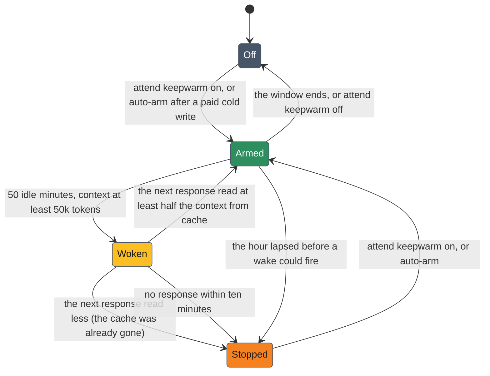

# Keepwarm — holding the prompt cache across idle time

Claude Code caches a session's prompt on the one-hour cache tier. Each request reads the cached prefix and restarts the hour. A request that arrives after the hour has lapsed writes the whole prefix again at the cache-write rate: on a 200k-token session that is dollars, against cents for a warm turn. Keepwarm is an attend sensor that, while armed, wakes an idle session once at 50 idle minutes so the next request reads the cache instead of rewriting it (ADR-182).

The wake is an ordinary Monitor notification. Claude Code turns it into a turn over the full context, and that request reads the cache and restarts the hour.

## When to arm it

Arm it before leaving a large session idle that you will come back to: lunch, a meeting, a long build in another window. It is not worth arming for a small context or for a session you will not return to. It is off by default, because every wake costs a cache read on an API key and an unknown share of the rate limit on a subscription.

```bash
attend keepwarm on          # arm for 6 hours
attend keepwarm on 90m      # arm for a window: 6h, 90m, 2h30m
attend keepwarm off         # disarm
attend keepwarm status      # the card below; also what bare `attend keepwarm` prints
```

These verbs act on the Claude session that runs them, so run them from inside the session (the agent's Bash tool, or `!` in the prompt). Outside a session they print `keepwarm: no Claude session owns this process, nothing to warm` and exit 1. The sensor itself runs inside `attend run`, so attend must be running under Monitor for anything to wake. In a session the attend mod hosts, the mod runs the same judgment with `attend keepwarm check` instead ([`mod.md`](mod.md)), and where autocompact is off it keeps the session warm with no arming at all (the keepalive policy, below).

**Auto-arm.** When the sensor sees a paid cold write (below) on a context of at least 50k tokens, it arms three hours on its own if no window already covers them. A session that has paid one rewrite has shown it comes back, and the second rewrite is not paid that day.

## The keepalive policy

In an interactive Claude Code session that runs the attend mod and has autocompact off, nothing needs arming: the mod keeps an idle session warm for a stretch the operator bounds, then asks the agent to wrap and lets the cache lapse ([ADR-414](../architecture/attend/ADR-414-the-attend-mod-keeps-an-idle-session-warm-for-a-bounded-stretch-after-the-operator-s-last-prompt-then-asks-for-a-wrap-and-lets-the-cache-lapse-while-autocompact-is-off.md)). It runs whether the session is listening or dormant, and never in a `claude -p` run or an SDK session.

- **The clock.** Every main-loop request restarts it, whatever started the turn: an operator prompt, an attend delivery, a keepalive, a background agent's notice. A keepalive is due at the newest request's time plus its cache tier's TTL, less `margin_minutes` (default 10, so 50 minutes on the hour tier). Nothing is due while a main-loop turn runs, on the five-minute tier, or under 50k tokens of context. At a due point whose cache has already lapsed (the host slept), nothing is sent and the policy stops until the operator's next prompt.
- **The bound.** attend counts the keepalives sent since the operator's last prompt. At each due point: under `max_keepalives` (default 8) and inside a window, the mod submits the `keepwarm:` line and the count goes up; otherwise, unless `wrap` is `off`, it submits one `wrap:` turn; otherwise the policy stops. After a wrap or a stop nothing more is sent until the operator prompts, and the cache lapses about an hour later. With the defaults the keepalives land 50, 100 and on to 400 minutes after the last turn, the wrap at 450 minutes.
- **What resets it.** A prompt the operator typed (the terminal, Remote Control, an SDK host's turn, the owner's Slack ping): the mod runs `attend keepwarm reset`. An attend delivery restarts the clock and leaves the count, since attend cannot tell a message the operator typed in attend-chat from a peer's.
- **The windows.** `windows` lists entries `<days> <HH:MM>-<HH:MM>`: `daily`, one day (`Sat`) or a range (`Mon-Fri`, `Fri-Mon` wrapping the week). `24:00` closes a day; an end before its start crosses midnight and belongs to the start's day. They are read in `timezone`, an IANA name, or the host's zone when it is empty. They gate keepalives only: outside them the next due point sends the wrap. The default `daily 00:00-24:00` leaves the count as the only bound; an empty list is never inside. An entry that does not parse is dropped and the status card names it.
- **The wrap.** The turn's first line gives the reason (`wrap: 7h30m since the operator's last prompt and 8 keepalives, the most this session allows.`), and its body asks the agent to run the wrap skill with `stay`, ask nothing, land nothing and start nothing. `wrap` routes the final reply: `transcript` (the default) leaves it there; `file` has the mod write it to `wrap_file`; `send` has the mod send it over attend to `wrap_to` (empty for the operator's own member id, a session name, a project path or `#channel`) as one message opening with a `handoff:` line, written to `wrap_file` instead when attend refuses the send. A wrap turn that ends other than with an answer is written nowhere. `after_wrap: compact` has the mod compact the conversation once the wrap has answered, with the focus of its closing `/compact` line.
- **Armed windows.** `attend keepwarm on` overrides the count and the windows while its window is open, so no wrap is sent; `attend keepwarm off` stops the policy until the operator's next prompt. A paid cold write arms nothing where the policy runs.
- **Autocompact.** The mod reads `isAutoCompactEnabled` from the session's usage breakdown at start and before each check, falling back to `autoCompactEnabled` in the merged settings, where only an explicit `false` is off. A gate it cannot read counts as on. With autocompact on the policy does not run: a listening session keeps ADR-182's armed windows, and a dormant one runs nothing.

The keys sit under `attend_mod.keepalive` in the ways config and are set per project with `ways settings set <key> <value> --project <dir>` or in attend-chat's ☰ Settings ([`mod.md`](mod.md#configuration)).

| Key | Values | Default |
|---|---|---|
| `enabled` | `true`, `false` | `true` |
| `max_keepalives` | 0 to 48 | 8 |
| `margin_minutes` | 3 to 30 | 10 |
| `windows` | list of `<days> <HH:MM>-<HH:MM>` | `["daily 00:00-24:00"]` |
| `timezone` | IANA name, or empty for the host's zone | empty |
| `wrap` | `transcript`, `file`, `send`, `off` | `transcript` |
| `wrap_file` | path; `{state}`, `{project}`, `{session}`, `{date}` expand | `{state}/wrap/{session}.md` under the ways state root |
| `wrap_to` | for `send`: a member id, a session name, a project path or `#channel`; empty for the operator | empty |
| `after_wrap` | `lapse`, `compact` | `lapse` |

## What a wake looks like

With a window armed, the context at 50k tokens or more, and 50 minutes since the last assistant response in the transcript, the sensor emits one line:

```
[attend sensor=keepwarm priority=medium] keepwarm: 50m idle, the prompt cache lapses in 10m on 182k tokens. Reply with one word and no tools.
```

The idle clock is the session transcript, not attend: any response resets it, whether it answered the user, a peer message, a drained inbox message, a scheduled wakeup, or keepwarm itself. There is one wake per idle stretch.

Keepwarm rides the message lane with the peers sensor, so the action-potential refractory never holds the wake back.

## The agent's side

A line beginning `keepwarm:` asks for one word and no tools. It is not a prompt to investigate, summarize or check anything. The turn it produces is the whole point, and anything more is billed output. The same sentence is in the three guidance files agents read: the attend skill, the runtime disclosure, and the attend way.

## How it stops



The verdict comes from the first response after the wake. A cache read of at least half the previous context means the cache was warm and the window stays armed. Anything less means the cache had already lapsed, so the sensor disarms and records why rather than keep paying for rewrites. What the response wrote does not count, since a real turn landing beside the wake can append a large tool result to a warm prefix.

## Status

`attend keepwarm status` reads the transcript through `ways context` and the sensor's ledger:

```
model       claude-opus-5
state       warm, 38m left
context     182400 tokens
cold cost   $1.82 to re-write it (warm turn $0.09)
keepwarm    armed, 5h12m left · wake in 28m
break-even  up to 20 wakes at the read rate cost one cold write, about 16h40m of idle at one wake per 50m
session     1 cold write paid, $1.64
```

| Line | Meaning |
|---|---|
| `state` | `warm` with the time left on the cache hour, `COLD` with the time since the last request, or no request yet |
| `cold cost` | what rewriting the current context would cost, and what one warm turn costs |
| `keepwarm` | `armed` with the window left and the next wake; `stopped` with the reason; or `not armed` |
| `mod setting` | only in a session the attend mod hosts: the effective `attend_mod.keepwarm` setting and the file that set it. With `off` the mod never runs the check, so nothing arms or wakes in that session |
| `keepalive` | where the mod has run the keepalive policy: the count of the maximum since your prompt, the next due point, the estimated wrap time and the windows; `off` with why (autocompact on, the policy disabled); `stopped` with why; or `wrapped` with where the reply went, a refused send's target and attend's reason included. Dropped window entries and an unknown timezone get lines of their own |
| `cost` | with the policy running: what its keepalives have cost since your prompt, the most still to spend in keepalives before the wrap, and a cold re-write now |
| `break-even` | how many wakes cost the same as one rewrite, and how much idle time that covers; left out for a model with no price |
| `session` | the cold writes this session has paid and their total |

The `keepwarm` line says `armed` and `not armed`, never `on` and `off`: those are the values of the mod's `attend_mod.keepwarm` setting, which says whether the check runs at all, not whether a window is armed now.

`attend peer status` shows the `keepwarm` line on its own.

## The cost model

A cold write is a response whose cache write is at least half the previous context and whose cache read is under half of it, with the previous context over 20k tokens. The sensor records each one with its price. A large tool result appended to a warm prefix writes a lot but reads the whole prefix, so it does not count.

Prices are a dated table in `tools/sensor-keepwarm/src/lib.rs`: cache read, one-hour cache write and output per million tokens, by model family, from list prices of September 2026. A model not in the table prices as `n/a`. On a subscription the dollars are a yardstick for the arithmetic, not a bill.

Each wake adds a user line and an assistant line to the transcript, on the order of a hundred tokens. A six-hour window adds under a thousand.

## Turning it off

`attend keepwarm off` disarms the current session. To remove the sensor from every session:

```bash
ways settings set attend.sensors.keepwarm.enabled false
```

or in `~/.config/attend/config.yaml`:

```yaml
sensors:
  keepwarm:
    enabled: false
```

`attend_mod.keepwarm: off` in the ways config (a project's `.claude/ways.yaml` wins) does the same for the attend mod: its sessions run no check, the keepalive policy included, so nothing wakes and a paid cold write arms nothing. `attend_mod.keepalive.enabled: false` turns off the policy alone and returns the project to the armed windows. A dormant mod session never gets an armed window's wake; with autocompact off it gets the policy's keepalives.

A disabled sensor neither wakes nor auto-arms. The arm file and the ledger live under `$XDG_CACHE_HOME/attend/keepwarm/`; only the `attend keepwarm` verbs and the sensor read them.

## Related

- [`sensors.md`](sensors.md#keepwarm) — the sensor's defaults beside the other built-ins
- [`delivery.md`](delivery.md) — the message lane keepwarm shares with the peers sensor
- [`configuration.md`](configuration.md) — the `sensors.keepwarm` keys
- **ADR-182** — the decision
- **ADR-414** — the keepalive policy
