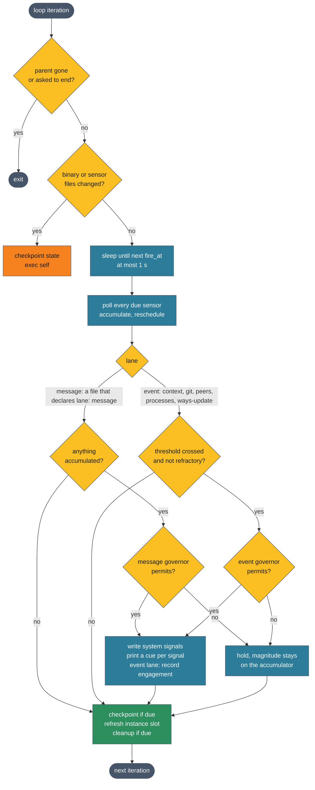
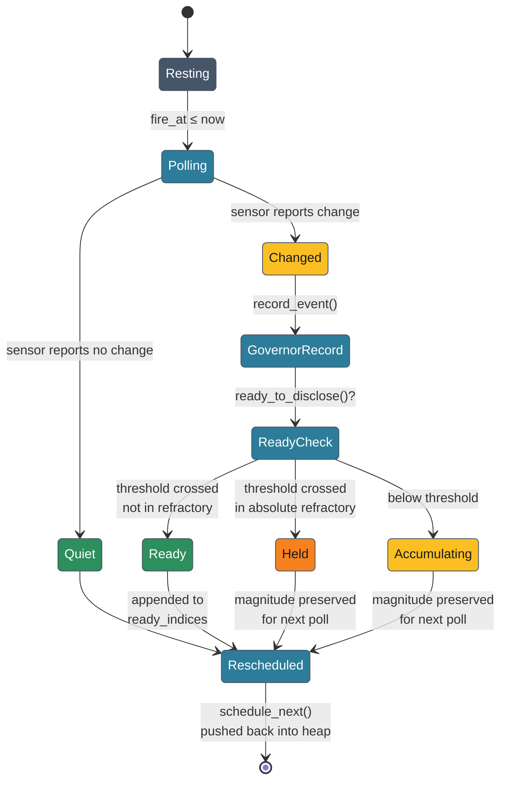
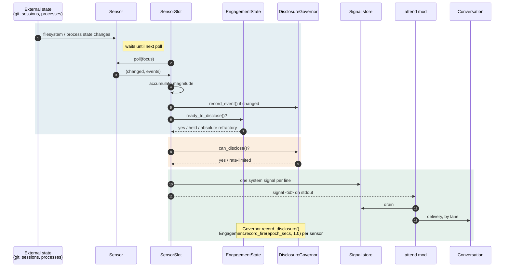

# The attend loop

attend's sensors run in one long-lived process per listening session, the sensor host. It runs a timer-driven sensor loop with no threads, no async runtime and no event subscriptions. Each iteration looks at a priority queue of upcoming sensor polls, sleeps until the next one is due, polls everything that is ready, decides whether to disclose, writes what it discloses into the signal store, and goes back to sleep.

This page covers what the host is, the rhythm of one iteration, the phases a sensor passes through inside that iteration, and how an observation leaves the host and reaches the session. Every other page in this directory refers back to something here.

The host serves one Claude Code session. A human reads the same message bus through attend-chat ([`tui.md`](tui.md)), which watches the signal files directly and does not run this loop.

## The sensor host

The attend mod starts the host as its own child when a session starts listening: `attend sensor host --session <id> --cwd <dir> --parent <pid>`. When the mod ends the host, starts it again, and gives up on it is described under [the attend mod](mod.md). A dormant session has no host, and a session without the mod has none either, so it gets no sensor reports.

- **Where a disclosed line goes.** Each line becomes a signal in the session's project tray, from `system:<sensor>`, addressed to the session, on the sensor's lane, with the expiry its trigger sets (`expires`; an unset one on the event lane is the hour of the decay window, and `session` keeps it until read). The mod's drain delivers it by its lane: an event-lane signal never starts a turn and reaches the session at the end of its turn or with the next delivery that wakes it, a message-lane one wakes the session as a message does, and one past its expiry is dropped unread ([system signals](delivery.md#system-signals)).
- **The event lane's cut.** An event-lane batch must reach magnitude 3.0 to be written. One under it is logged on stderr and not written. A message-lane batch has no such cut.
- **Stdout and stderr.** Each write prints one line on stdout, `signal <id>`, which the mod takes as a cue to poll at once. Nothing else goes to stdout. Logs go to stderr, which the mod sends to its debug log.
- **What it leaves out.** The host polls no messages and keeps no cache gate: the mod's drain delivers messages and decides what wakes the session. Keepwarm is not a sensor; the mod runs `attend keepwarm check` itself ([`keepwarm.md`](keepwarm.md)). The peers sensor reports presence alone, on the event lane.
- **Its name.** The host holds the session's instance slot, the suffix of the name peers see it by (`Chaucer-alpha`), and refreshes it every minute. `attend peer whoami --display` prints the name.
- **A trigger kept for the session** (`memory: session`) offers its lines once and fires nothing while the loop holds them, such as behind the governor. It is spent once every line it offered was written or held under the cut, and the checkpoint follows at once, so a restart after that does not fire it again. A line dropped on its way, by the refractory, a write that fails, or a governor hold that a restart ends, leaves the trigger to fire again on the next poll that meets it. A kill between the write and the checkpoint can repeat the notice.
- **After `/clear`.** The mod ends the host and, once it has exited, starts one for the new session id with `--moved-from <old id>`. The new host moves the old id's sensor stores and the triggers kept for the session to the new id, and moves the old id's instance slot before it registers, so the session keeps its name.
- **When it exits.** The host exits when its parent process is gone. It reads its parent first thing, so a parent that exits while it starts is seen. One that exits before attend's `main` runs is not: the host was adopted already. `--parent <pid>` names the process to watch, and the host exits when that pid is not running, checked before any sensor starts and on every pass of the loop. The mod passes Claude Code's pid. TERM, HUP or INT ends the host within a second. A closed stdout, which means the mod stopped reading, ends it at the next cue it writes, once that tick has checkpointed.

`attend peer status` lists the running hosts, one per listening session.

## The rhythm

The loop is **pull-based, not push-based**. Nothing wakes it up: it wakes itself at timestamps it already knows about, does one unit of work, and goes back to sleep. Its only input is the machine's state: git state, the process list, session records, transcript usage, and whatever a `command` or `mcp` sensor reads. Sensors read these during their own scheduled polls.

The implication for latency: the host's response to an external change is bounded by the polling interval of the sensor that watches the relevant thing, not by a tick rate. A branch switch happens at once, but the git sensor does not see it until its next poll, `min_interval` 10 seconds in its shipped file.

The implication for cost: when nothing is happening, the host is asleep almost all the time. It wakes at least once a second to check its parent, which costs next to nothing.

## Startup

Before the loop begins, `cmd_host` builds the context it needs:

1. **Parent and arguments.** Read the parent process, and exit if `--parent` names a process that is gone. Refuse with a usage error (exit 2) when `--cwd` is not a directory or `--session` is an id no signal can be addressed to.
2. **Moved stores.** With `--moved-from`, move the old id's sensor stores to the new id.
3. **Instance slot.** Take or keep the session's instance slot in the project, after moving the old id's slot with `--moved-from`.
4. **Leftover servers.** End the MCP servers that a host killed with SIGKILL left running for this project.
5. **Config.** Load `~/.config/attend/config.yaml`, then overlay `<cwd>/.claude/attend.yaml` on top.
6. **Sensor registration.** `sensors::register_host_sensors()` loads the sensor files, shipped, user and project ([`authoring-sensors.md`](authoring-sensors.md#where-sensor-files-live)), and builds a slot for each one that runs, under its file's intervals, threshold and lane. It first removes sensor stores past retention or of an older format. A sensor that does not run, other than one that is off, is logged once on stderr with its state.
7. **Engagement state.** Apply the action-potential engagement parameters to every slot. Refractory behavior is per sensor but the parameters are shared.
8. **State restore.** If `$XDG_CACHE_HOME/attend/state/<session-id>.state` exists from a previous host, import the context sensor's disclosed thresholds and each file sensor's session memory, so a restart is continuous. With `--moved-from`, a sensor with no session memory under the new id takes the old id's.
9. **Stamp sweep.** Remove the `.last-inbound` and `.banner` stamps of sessions that are gone and whose state files are all older than 7 days. A session with a record is gone when the record is; a pid-fallback stamp is gone when its Claude Code process no longer runs with the same start time. Each start examines at most 2000 stamp keys and leaves the rest for a later start.
10. **Governors.** Build the event lane's `DisclosureGovernor` from the configured cooldown, rate window and maximum per window, and the message lane's permissive one ([below](#disclosure-and-the-governor)).
11. **Priority queue.** Push every sensor slot into a `BinaryHeap<ScheduledSensor>` keyed by `fire_at`.

Then the loop begins.

## One iteration

The parent check runs every iteration, so the host sees its parent leave, or a TERM, HUP or INT arrive, within a second.

The reload branch replaces the process with a fresh copy of the binary (`execve(2)`), keeping the pid and the pipes, so the mod reading the host does not notice. The host checks every 10 seconds. A changed binary takes this branch, and so does a sensor file added, changed or removed in the user or project sensor directory, or a change to `attend.project_sensors`; the log names the reason. A rebuild whose bytes match the running binary does not. State is checkpointed first, and the new process restores from that checkpoint during startup, so engagement history, disclosed context thresholds and the triggers kept for the session survive the reload.

## The sensor queue

`BinaryHeap<ScheduledSensor>` is a min-heap ordered by `fire_at`: the soonest-scheduled sensor is always at the top. The loop peeks it to find the next wakeup, sleeps that long or one second, whichever is shorter, then drains every sensor whose `fire_at` has passed.

Draining matters: if two sensors both came due during the sleep, they both poll in this iteration. This keeps the loop from falling behind during bursts.

After each poll, the sensor's `schedule_next()` computes its next `fire_at` from whether it observed anything, the action-potential engagement state, and its `min_interval` floor. The updated entry goes back into the heap.

Scheduling dynamics:

- **Quiet sensor**: interval grows toward `base_interval()`. Polls become less frequent.
- **Active sensor**: interval shrinks toward `min_interval()`. Polls become more frequent.
- **Refractory sensor**: interval still runs, but the effective threshold is elevated so polls that would normally cross threshold are suppressed. See [`engagement.md`](engagement.md).

## One sensor's lifecycle within an iteration

Each drained sensor walks through a short state machine before control returns to the loop body:

**Quiet** is the happy path when nothing changed. The sensor's interval grows, its accumulator stays at zero, the loop logs nothing, and it sleeps until next fire.

**Changed but below threshold** means the sensor saw something but the magnitude is not high enough to disclose yet. The event is accumulated in the sensor's `DeltaAccumulator` and will be combined with future events if they arrive before the accumulator decays.

**Changed, above threshold, but held in absolute refractory** means the action potential (ADR-123) is actively suppressing this sensor after a recent burst. The magnitude stays on the accumulator but the sensor is not added to `ready_indices`. The log line `held in absolute refractory` marks this case.

**Ready** means the sensor crossed threshold and engagement state permits disclosure. The sensor index is appended to `ready_indices`, which the loop processes in a batch after draining.

The state machine above is the event lane's. A sensor whose file declares `lane: message` is ready whenever anything has accumulated: it has no threshold check and no refractory. No shipped sensor that is on rides the message lane (the disabled `example-mcp.yaml` declares it, as an example); a file sensor that carries words a person wrote, such as chat read through an MCP server, declares it with an `author` ([`authoring-sensors.md`](authoring-sensors.md)).

## Disclosure and the governor

After all due sensors are polled, the ready ones split by lane, and each lane asks its own `DisclosureGovernor`. The governor is alarm management (ISA-18.2) applied to the session: it bounds how often attend may report, no matter how much the sensors want to say. Each enforces two limits:

| | Event lane | Message lane |
|---|---|---|
| Cooldown between disclosures | `governor.base_cooldown` (default 15 s) | 3 s, fixed |
| Disclosures per window | `governor.max_per_window` per `governor.rate_window` (default 3 per 120 s) | 30 per 60 s, fixed |

If the lane's governor permits, the loop builds a batch:

1. For each ready sensor, drain its events into a list of lines, each with the expiry its trigger set.
2. Append `(sensor name, accumulated magnitude, lane, lines)` to the batch.
3. Hand the batch to the host's sink, which writes each line as a system signal and prints `signal <id>` for each write. An event-lane disclosure whose magnitude is under 3.0 is logged and not written.

After the batch, if any line was written, the loop records a disclosure on that lane's governor. On the event lane it also records engagement for every sensor whose magnitude reached 3.0, so quiet filler does not escalate the refractory. The message lane records no engagement.

If the governor rejects the batch, the magnitudes stay on the accumulators and the loop logs `N sensors ready but governor holding (X/Y in window)`. The next time the governor window rolls, those accumulated events go out together.

## Signal flow end-to-end

This is the one-way data flow. Observations enter through sensors reading the environment, and leave as signals in the store, which the mod's drain delivers ([`delivery.md`](delivery.md#system-signals)). Nothing in the host is event-driven: every transition is a poll that happened to find something new.

## Timers running in parallel

All of these tick inside the same single-threaded loop, as `Instant::now()` comparisons against stored last-time values:

| Timer | Interval | Purpose |
|---|---|---|
| Per-sensor poll | `slot.next_fire` (varies) | Primary loop rhythm: when to poll each sensor |
| Parent and stop check | every iteration, at least once a second | Exit once Claude Code is gone or a signal asks |
| Self-reload check | 10 s | Detect a changed binary or sensor file, exec self |
| Checkpoint | 30 s, and at once after a trigger kept for the session is spent | Save sensor state for restart continuity |
| Instance slot | 60 s | Keep the session's instance slot fresh, and take a new one if it was collected |
| Cleanup sweep | `cleanup.interval` (default 600 s) | Prune stale signal files and empty project dirs |
| Sensor min_interval | per sensor (default 10 to 20 s) | Floor on polling frequency |
| Sensor base_interval | per sensor (default 30 to 60 s) | Ceiling: rest-state polling frequency |
| Event governor cooldown | `governor.base_cooldown` (default 15 s) | Minimum gap between event-lane disclosures |
| Event governor rate window | `governor.rate_window` (default 120 s) | Rolling window for the event-lane rate limit |
| Message governor | 3 s, 30 per 60 s | The message lane's limits |
| Absolute refractory | `engagement.absolute_refractory` (default 60 s) | Full suppression after a burst, the `Curve::ActionPotential` hard gate |
| Multiplier half-life | derived from `engagement.decay_per_minute` (default 0.1, about 395 s) | Exponential half-life of the relative-refractory multiplier's decay back toward 1.0 |

The engagement parameters are all in wall-clock seconds because the host's progression axis is `sensor_trait::epoch_secs()`. The burst window is implicit in the multiplier's half-life rather than a parameter of its own; see [`engagement.md`](engagement.md#event-count-burst-detection).

The loop does not coordinate these timers explicitly. Each is a separate check of whether enough time has passed, at its point in the iteration. The loop body walks through them in a fixed order, so behavior is deterministic.

## Loop termination

The loop ends in one of these ways:

1. **Parent gone.** The process that started the host, or the pid `--parent` names, is no longer running. The host returns, and the sensors it drops end their MCP servers.
2. **A signal.** TERM, HUP or INT sets a flag the next iteration reads, and the host returns as above. A SIGKILL ends nothing, so the next host for the project ends the MCP servers it left.
3. **Closed stdout.** A cue meets a closed pipe: the mod stopped reading. The host exits once the iteration that wrote it has checkpointed.
4. **`execve` via self-reload.** The process image is replaced and control never returns to the loop. State is checkpointed first, so the replacement restores cleanly.

The most recent checkpoint is the restore point. Magnitude accumulated but not disclosed since then is lost, which is acceptable because accumulation is ephemeral by design; the 30-second checkpoint bounds the loss.

## Where to go from here

- **Writing new sensors**: [`authoring-sensors.md`](authoring-sensors.md), the sensor file spec, and how to write a sensor that plays nicely with this loop.
- **Human mode**: [`tui.md`](tui.md), the `attend chat` screen on the same signal bus.
- **Sensors individually**: [`sensors.md`](sensors.md) covers what each shipped sensor observes and how it reports.
- **Engagement curve**: [`engagement.md`](engagement.md) covers the action potential model, and why event-lane sensors go quiet after bursts.
- **Delivery**: [`delivery.md`](delivery.md) covers how the mod and the Stop-hook drain deliver what the host writes.
- **Signal format**: [`signals.md`](signals.md) covers the wire format, on-disk layout, and lifecycle.
- **Configuration**: [`configuration.md`](configuration.md) covers the YAML overlay and how to reshape any of the timers above.

## References

- ADR-416: the sensor host, its stdout cue, the system signals it writes and what it keeps of the loop it replaced.
- ADR-115: the user config overlaid by the project's.
- ADR-123: the action-potential engagement parameters, and the burst window implicit in the multiplier's half-life.
- ADR-137: the cap on stamp keys one start examines.
