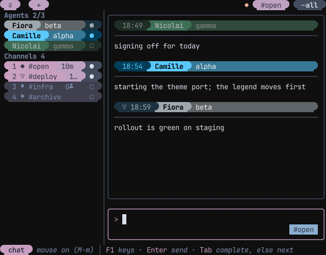
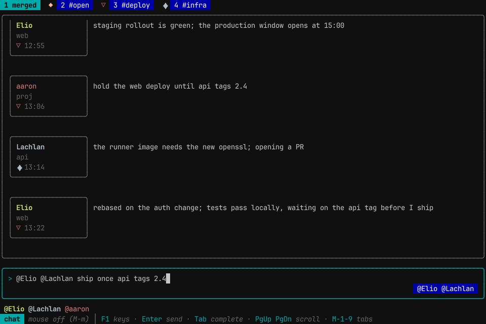
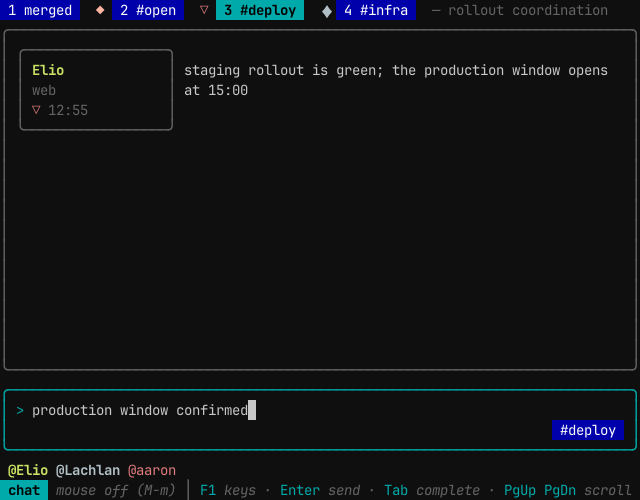
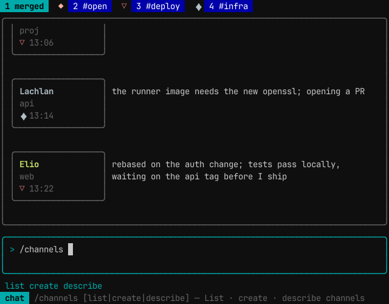
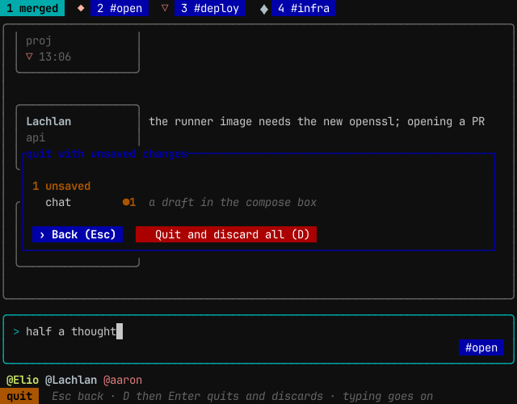

# `attend chat` — the human on the bus

`attend chat` opens attend-chat, a terminal screen that puts a human on the same message bus the Claude sessions use. The human reads every channel the bus carries, addresses agents by name, and runs channel commands, all through the signal files `attend message send` and `attend message inbox` use. The decision is ADR-120. ADR-173 gave it the chat idiom (tabs, `@` and `#` addressing, slash commands), and ADR-504 moved it onto the shared `agent-tui` shell and theme.



## Starting it

```bash
attend chat          # runs the attend-chat binary
attend-chat          # the same, directly
```

`attend chat` passes its arguments through to `attend-chat`. The screen needs a terminal on stdin and stdout. Started anywhere else (a Monitor, a pipe) it exits and points at `attend message inbox` and `attend message send`.

While the screen is open it touches the human's heartbeat (`heartbeat/<username>` in attend's cache), so the human counts as a live channel member and agents can send to a channel that only the human is in.

## The screen

From top to bottom, beside a left column:

- **The left column** (ADR-405). Agents: every agent the chat has seen, from session records and senders, live ones first and the rest set back. Channels: `#open`, then every channel, including empty ones and ones whose directory was swept, each numbered from 1 for Ctrl+digit (`#open` is 1) and shown with its member count and the time since its last message. The shown channel is marked, and so are the agents in it, the human included, while a created channel is shown. A click on a claude's row shows the direct messages between you and that agent, both ways, and lists that DM view on a row under the agent's (ADR-405); the feed shows those DMs alone, a received one labelled `→ you` and a sent one `→ @Name`, and the compose box sends a direct message to the agent, with the destination flag reading `@Name`. A click on the agent whose DMs are shown, or Enter on its row, opens its menu: Show DMs or Hide DMs, Address @Name (puts `@Name ` in the compose box), Who is this (what `/whois` says, or for a quiet agent what the chat knows of it), and Remove from #channel when the shown channel lists it, live or quiet; Remove asks for `y`. A right click on an agent's row opens its menu at once and keeps the channel shown. Hide DMs, on the agent's menu or on the DM row's own, takes the row off the column and deletes nothing; the operator view takes the hidden view's place, and the DMs show there among everything else. A human's row has no DM view, so a click on it opens its menu at once. A click on a channel shows it, and a click on the channel shown opens its menu, as Ctrl+digit does (ADR-407); a channel whose directory was swept cannot be shown, so a click on its row opens its menu at once. A menu docks where its input came from: under the row clicked, under the tab for a click on a tab, and for a key under the channel's row when the column shows it, else under its tab. It ends on the line above the row where the rows below cannot hold it. With `attend.chat.tabs.menu_on_repeat` off, a click or Enter on the shown channel's row still opens its menu. From the keyboard the column's rows are on the focus ring (see Focus below): Up and Down move along them, Enter opens the row's menu, a digit on a channel's row picks a channel by its number (agents carry none, so on an agent's row a digit is typed in the compose box), Up at the top goes to the tab bar and Esc opens the `≡` menu. A click outside the column, or a terminal too narrow for it, gives the keyboard back to the compose box. A list longer than its rows scrolls: the cursor keeps itself in view, the wheel over a list moves it a row at a time, and the header marks rows above with ↑ and below with ↓. F3 (`attend.chat.sidebar_key`) shows or hides it, and a terminal narrower than 76 columns hides it.
- **The tab strip.** `≡`, then the created channel shown with its description, or the DM view shown as `@Name DMs` on the shaded ground of a view, then `+` on the left; the reserved tabs pinned at the right end: `#open`, then `⋯all`, the operator view of every channel together, drawn on a shaded ground and carrying no `#` (ADR-405, ADR-407). There is no tab per channel: the left column lists and numbers them. While the column is hidden, by F3 or a terminal too narrow for it, each channel's tab carries the column's number before its name, so Ctrl or Alt and a digit stay on screen. The created channel shown carries its member count after its name, the human included; `#open` holds everyone and carries none. While `#open` or the operator view is shown, the left holds `≡` and `+` alone. The channel tab leads with the channel's glyph in its colour. A narrow bar cuts the description, then the name; `≡`, `+` and the reserved tabs stay whole.
- **The message feed.** Each message opens with one header line across the feed (ADR-410): a band in the sender's colour, the same lozenge the left column draws for the agent, holding the glyphs of the channels the sender is in and the time, then the sender's name (the same persona name the Monitor line and the drain use, such as `Elio`, or the username for a human), then the basename of the sender's working directory. On a narrow feed the name and directory are cut, never the time. A rule runs under the header and the body wraps below it at the feed's full width. A click on a message selects it and draws its rule heavy; a right click on its header opens the sender's menu.
- **The compose box.** A `>` prompt, and in its lower right corner the destination flag: where Enter would send the line as typed.
- **The helper row.** Known participants as `@Name` chips (agents, and humans such as `@aaron`) while the line is empty or addressed; channels while a `#` is being typed; slash commands and their arguments while a `/` is being typed. While the left column is shown, it lists the agents and channels instead, underlining what Tab would complete to, and the row appears only for slash commands.
- **The bottom bar.** The mode, the mouse state, and the main keys. Command results and errors appear here for a few seconds.

The operator view (`⋯all`) shows every channel and the human's own tray in one stream. A channel tab shows only that channel. Messages are not threaded or faded: the feed is chronological, and a message stays until a mark or a tombstone hides it, or Hide messages here (`/clear`) hides it in one tab.

## Addressing

What Enter does depends on how the line starts:

| The line starts with | It goes to |
|---|---|
| plain text, on the operator view | `#open` |
| plain text, on a channel tab | that channel |
| `#name` | that channel, from any tab |
| `@Name` | that agent's project tray |
| `@Name @Other …` | each named agent's tray, one signal per recipient |
| `/` | a slash command, never the bus |

The run of leading recipients can mix `@` and `#`. Every recipient is resolved before anything is written, and one bad address rejects the whole line so it can be fixed and sent again. A send to a channel with no live member other than the sender is rejected the same way.



On a channel tab the destination flag shows the channel, so an unaddressed line is visibly scoped before Enter is pressed:



`#123` inside a message body is plain text. The receiving agent resolves an issue reference against its own repository.

## Slash commands

A line that starts with `/` runs a command. The helper row completes the command name, then each argument, and the bottom bar shows the help for the part being typed. A command that takes no channel acts on the foreground tab's channel.

| Command | What it does |
|---|---|
| `/help` | list the commands |
| `/whois @Name` | show a peer's session id and origin directory |
| `/peers` | list live peer sessions |
| `/join #name` | join a channel |
| `/leave [#name]` | leave a channel |
| `/dissolve [#name]` | remove a channel; refused while it has a live member |
| `/channels [list]` | list channels with member counts |
| `/channels create name [description]` | create a channel without joining it |
| `/channels describe #name [description]` | set a channel's description; empty clears it |
| `/invite @Name [#name]` | send the peer a message asking it to join; the peer joins itself |
| `/kick @Name [#name]` | remove a member from a channel and tell it so |
| `/purge [#name]` | Delete read messages for everyone… with All, on the channel named or shown; kept one release as an alias |
| `/clear` | Hide messages here, on the tab shown |

`#open` cannot be joined, left, dissolved, kicked from, invited to or described: every session is already in it. Its read messages can be deleted for everyone.



## Focus

One element has the keyboard at a time, and it alone is drawn focused: a tab reversed behind `▸`, a column row reversed behind `▸`, the feed or the compose box by an accent border. A box without the focus has the subdued border, the compose box included, and the compose caret shows only while the box has the focus. The bottom bar's lozenge says where the focus is (`chat`, `tabs`, `view`, `column`, `feed`), and the footer names that element's keys.

The focus ring, in order: the tab bar as drawn (`≡`, the created channel or DM view shown, `+`, `#open`, `⋯all`), every agent row, each followed by its DM view's row while that is listed, and then every channel row of the column while it is drawn, the feed, the compose box, and round again. Tab walks it forward and Shift-Tab back, so N presses of one undo N of the other. In the compose box every key edits; Tab completes the `@name`, `#channel` or `/command` being typed and, where completing would change nothing (no match, or the one match already in place), leaves the box forward. The footer says "S-Tab or ↑ at the top leaves the box". Up at the start of the first line and Down at the end of the last leave only a box that holds text, so an arrow pressed from habit never turns what is typed next into commands (ADR-409).

The compose box and the feed are the chat: in the feed a character goes to the box and is typed there, `q`, `m` and `?` included. On the tab bar and in the column, Tab or Right moves forward and Shift-Tab or Left back; the help keys work (`?`, `m`); `q` asks before it quits; on a channel's row a digit picks a channel by its number. Any other character, a digit on an agent's row included, goes to the box and is typed; Backspace and Delete only go back to it. Enter opens the focused element's menu everywhere outside the box: a tab's or a row's, the one a right click opens, and in the feed the selected message's (Reply, Quote, Address, Copy). Walking the tab bar shows nothing. The focus on a tab stays on that tab when channels come and go, and moves to the tab shown when its tab leaves the bar. A click puts the keyboard back in the compose box, but for a click in the column or the feed while the focus is there.

Esc moves along one cycle: the compose box, the feed, the `≡` menu, the tab or column row the focus was last on (the feed when there is none), the `≡` menu again, and so on. The draft stays as it is. Leaving the compose box onto `≡` with Tab, or with Down at the end of its last line, does not count as a visit: the cycle comes back to the tab or row focused before. The `≡` menu Esc opened returns the focus there however it closes, by Esc, a click outside or an item picked, and the next Esc after any menu closes is the cycle's next stop, so a double Esc outside the box ends on the `≡` menu. A menu, a question, the key help or the entry dialog that is open takes the first Esc.

Where the terminal does not speak the kitty keyboard protocol, Ctrl-3 arrives as the same byte as Esc and is an Esc stop: from the compose box the feed, from the feed, a tab or a row the `≡` menu. An Alt and digit chord split across two reads arrives as Esc then the digit: an Esc stop, then the digit typed. Neither loses the draft or quits.

## Keys

| Key | Action |
|---|---|
| Enter | send, or run the slash command |
| Ctrl-Enter | send now, to a quiet agent too, as Claude Code's `chat:sendNow` does (ADR-409, amendment of 2026-10-13). A send refused because its agent is quiet says `press Enter again to send: @Name is quiet (no heartbeat)`, and Enter again on the unchanged draft sends it on any terminal; any edit withdraws the offer. An agent whose process has exited is refused whatever the key. Ctrl-Enter needs a terminal that speaks the kitty keyboard protocol; elsewhere it arrives as Enter |
| Shift-Enter, Alt-Enter | new line |
| Tab | complete the `@name`, `#channel` or `/command` being typed, over the agents (claudes, live or quiet) and channels (swept ones too) the left column lists; with nothing to complete, leave the compose box forward |
| Ctrl-1 … Ctrl-9, Ctrl-0 | show the column's channel by its number (`#open` is 1), or with 0 the operator view; on the channel already shown, open its menu. Needs a terminal that speaks the kitty keyboard protocol; the F1 view says whether yours does |
| Alt-0 … Alt-9 | the same where Ctrl and a digit do not arrive; Konsole and GNOME Terminal keep Alt and a digit for their own tabs |
| 0 … 9 | on a channel's row in the column, the channel by its number; anywhere else, an agent's row included, a digit is typed |
| F2, Ctrl-T | the focus to the tab shown, a reversed, ▸-led tab, and again back to the compose box |
| Ctrl-N | ask a new channel's name in an entry dialog docked under `+`, from anywhere. The compose box is for chatting and is never borrowed, so its draft stays as it is (ADR-409). Enter creates the channel, or says inside the dialog what is wrong with the name; Esc or a click outside closes it. Describe… asks its line in the same dialog. Ctrl-C asks first over a name typed there, and going back opens the dialog again |
| right-click a tab | its menu; a click on a tab shows it, and on the tab shown opens its menu |
| F3 | show or hide the left column |
| PgUp, PgDn | scroll the feed |
| Left, Right, Home, End | move the cursor; outside the compose box, Left and Right walk the focus ring |
| Shift-Tab, Up, Down | leave the compose box: Shift-Tab backward; with text in the box, Up at the start of its first line backward and Down at the end of its last line forward. Elsewhere Up and Down move along the column and through the feed's messages |
| Backspace, Delete | edit |
| Alt-m | turn mouse capture on or off |
| F1 | the key help |
| Ctrl-C | quit, asking first over a draft. `≡` → Quit does the same |
| Esc | close what is open (a menu, a question, the keys, the entry dialog); with nothing open, the next stop of the Esc cycle: from the compose box the feed (the selected message and the status line cleared, the draft kept), from anywhere else the `≡` menu, and from that menu back to the tab or row last focused. Esc never quits, and Ctrl-3 arriving as Esc where Ctrl and a digit do not arrive is an Esc stop that cannot close the chat (ADR-409) |

**Tab menus.** `≡`, first on the bar and unnumbered, is the common menu: Theme (this session's look; `ways settings set theme.active` keeps one), Keybinding set (presets over the tab keys), Mouse on or off at start, Hide column or Show column (the left column, with no key needed), Settings (every chat setting with its value and layer, a line each, in a window that Esc closes; `/config <key> <value>` sets one), Quit. Theme and Keybinding set open beside their row and mark the current value with `●`. The operator view: Hide messages here only, for it is not a channel. `#open`: Hide messages here, Delete read messages for everyone…. A named channel: Add agent (invites a live peer; it joins itself, as an agent's own Add agent to chat does), Remove agent (every member, quiet ones too; asks for `y`), Describe, Delete read messages for everyone…, Leave (or Join, for a channel the human is not in), Seal, Delete channel. Seal waits on attend work, ADR-404 D4: it is drawn set back with what it needs, the highlight passes over it, and a click on it does nothing. Add agent and Remove agent open their pickers beside their row. A click on the tab or the row that opened a menu closes it, wherever it docked. The `+` slot asks a new channel's name in the entry dialog. Hide messages here, Delete read messages for everyone…, Leave, Delete channel, Remove and Tombstone… ask first, since a click opens a menu with the first item under the cursor: `y` goes ahead; Esc, a tab change or a click keeps it, and any other character keeps it and goes on into the draft.

**Cleanup.** Hide messages here hides, in the tab it is chosen on, every message the tab holds then: a watermark kept in attend-chat's state file (`$XDG_STATE_HOME/attend-chat/hidden`) across restarts. Nothing on the bus changes, and other tabs still show those messages. Delete read messages for everyone… asks Delete older than: Current sessions, Today (local midnight), All, or Custom… (a duration such as `2h` or `3d`, or a date `YYYY-MM-DD`, in the entry dialog). It runs `attend message delete --dry-run` for the tab's scope (`--open`, `--channel <name>`, or `--dm <session>` for a DM view or an agent's row), and the question says how many go and how many stay unread by live sessions; `y` runs the delete, the status line names its batch, and the scope's menu then offers Undo delete (`attend message delete --undo <batch>`). A DM view's row and tab and a claude's row in Agents carry Hide messages here and Delete read messages for everyone… for the DMs between the operator and that agent. A claude whose session is not live has Tombstone… on its row and on its own DM view's menu: it runs `attend message tombstone <session-id>`, and attend's refusal is shown as attend words it. The verbs run through the `attend` installed beside attend-chat, else the one on `PATH`, on a worker thread: the status line says `asking attend…` while it works and the screen stays live, a second request waits for the first, and an attend that gives no answer in 10 seconds is stopped and said so. An attend too old to have a verb is named on the status line as needing a newer attend. Each other item runs the slash command that does the same thing.

**Joining after an invitation.** An agent that joins a channel late is not handed the channel's history: messages older than two minutes are marked read, and the join says how many. A join that answers an invitation (`/invite`, or Add agent) is the exception: the invitee's `attend channel join` keeps the channel's newest 50 messages to read, as a briefing, and says how many older ones it held back. The invitation is spent by that join.

**Settings.** `attend.chat.tabs.jump` (auto, ctrl, alt, both, none), `attend.chat.tabs.menu_on_repeat`, `attend.chat.tabs.focus_key` (both, f2, ctrl-t, none), `attend.chat.mouse` and `attend.chat.sidebar_key` (f3, ctrl-b, none; Ctrl+B is tmux's prefix, and none keeps the column shown) live in attend's user file. `/config` lists them with the layer each comes from, and `/config <key> <value>` sets one; `ways settings` reads and sets the same keys.

To see whether a terminal speaks the kitty keyboard protocol, run `printf '\e[?u\e[c'; read -rsd c -t1 r; printf '%q\n' "$r"` in it: a reply holding `[?` followed by digits and `u` means it does; one holding only the `c` answer means it does not.

**The mouse is on at start** (`attend.chat.mouse`, ADR-407). A click on a tab or on a channel's row in the left column shows that channel, and a click on the channel shown opens its menu. A click on a claude's row shows its DM view, and a click on the agent shown opens its menu; a human's row opens its menu at once. A right click on a tab, a column row or a sender's name in the feed opens that menu at once, showing nothing; on a sender it is the agent's own menu, as its row in the column has. A click or a right click on the destination flag under the compose box opens the menu of the channel it names, docked at the flag: `#open`'s on the operator view, since a clicked element acts on what it shows. Every one of these inputs, keys included, goes through one path, so a tab, its digit and its row land in the same state. A click on a message selects it and scrolls it fully into view, a click in the compose box places the cursor, a click on a helper chip completes it, and the wheel scrolls what is under it: a column list, the feed, or an open menu, key help or report; over the compose box it does nothing. Shift-drag selects text in most terminals while the mouse is on. Alt-m gives the terminal its mouse back, so plain dragging selects text and middle-click pastes into the compose box; `attend.chat.mouse: false` starts that way.

**Quitting with a draft.** Ctrl-C, or `≡` → Quit, quits at once when the compose box is empty. Outside the compose box, `q` asks `quit?` first, whatever is unsaved. With a draft in it, a prompt names the draft and offers Back (Esc) or Quit and discard all (D). Esc or Enter goes back. D arms the discard; then Enter or Ctrl-C quits and Esc disarms. Characters and editing keys go on typing into the draft, and after an armed D the D is typed too. Other keys, such as Tab or PgUp, leave the prompt as it is.



## Colour

The colours come from the agent-ways theme, chosen with `ways settings theme`. Sender names and channel glyphs keep a fixed categorical palette, so a sender has the same colour in every tab. Colour depth is detected from the terminal; `--depth truecolor|256|16|none` overrides it, and `none` draws with attributes only.

## Headless frames

`--snap WxH` prints one frame in `agent-tui`'s text frame format and exits, without a heartbeat. `--keys` plays keys before the frame: space-separated tokens such as `text:hi`, `enter`, `tab`, `esc`, `alt-3`, `f1`, `click:COL,ROW` and `wheel:up@COL,ROW`. A snapshot is a dry run: Enter sends nothing and runs no slash command.

```bash
attend-chat --snap 80x25 --keys "alt-3 text:@Elio hello"
```

## What it does not do

It does not replace the agents' terminals. Editing code and reading long output happen there. It does not start or stop agents, fetch issues, or thread replies; `attend message reply` threads on the wire, and attend-chat shows replies as ordinary messages.

## Related

- [`channels.md`](channels.md) — channel membership and lifecycle
- [`signals.md`](signals.md) — the files attend-chat reads and writes
- [`delivery.md`](delivery.md) — how a message reaches an agent session
- [`../cli/attend.md`](../cli/attend.md) — the `attend` CLI reference
- **ADR-120** — the chat surface, human in the signal loop
- **ADR-173** — the chat idiom across the attend command surfaces
- **ADR-504** — one TUI engine and one theme
