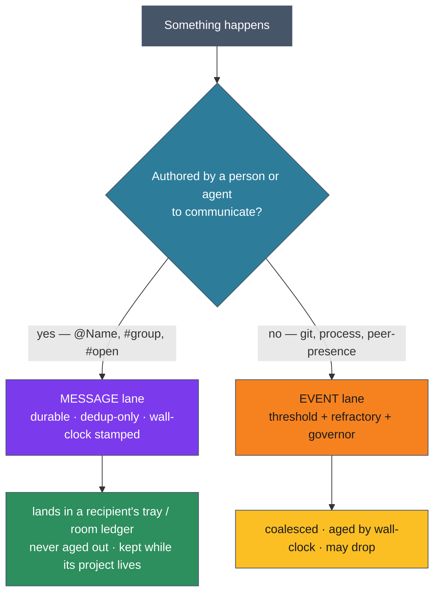

# Attend messaging and awareness — the model

This is the **explanation** companion to the decision that split attend's messages from its observations (listed under References). That record argues *why* attend should split into two lanes; these pages show *how the system behaves* once it does — across one, two, and many Claudes, with sub-agents, across dimensions, and with a human on the wire.

If you read nothing else, read this page, then [[04.002.E]] (the cast). The numbered scenarios are independent — pick the shape that matches your situation.

## The one distinction everything hangs on

Attend carries two kinds of traffic, and they want opposite handling.

- **Authored communication** — `attend message send`, `attend message reply`, attend-chat's
  `@Name` / `#group` / `#open`. A colleague chose to say this. It must be
  **delivered, once, and survive a brief absence.**
- **Environmental events** — git churned, a peer appeared, a process started. The phone ringing. These are *noise* by design; the whole threshold / refractory / governor stack exists to **suppress** most of them so a session is only woken for something that moved.

The office analogy: workers talk back and forth (durable conversation); the phone rings and faxes arrive (interrupts you can queue or ignore); the fax in your tray waits for *you*: it is not cleared on a timer, only when the office it belongs to closes.

## Two clocks

attend and the ways/steering system live in **different time dimensions**, and
the boundary between them is where messaging gets subtle.

| | attend | ways / steering |
|---|---|---|
| clock | **wall-clock** (real time, runs between turns) | **epoch / turn** (per prompt, no wall-clock) |
| job | notice what changed in the world | shape how the agent reasons this turn |

The **delivery is the bridge**: a wall-clock event crosses into the turn-stream when the attend mod submits it as a turn, or when the Stop hook hands it to the turn that is ending. That crossing is why re-entry is a
**batch, not a replay**: a burst of N wall-clock messages must become *one*
turn, because the receiving dimension is turn-discrete and context-precious.

## What this buys each lane

Both lanes timestamp everything; they *use* time oppositely:

- The **event lane** uses time to **decay and drop** — a stale observation is less worth a wake-up.
- The **message lane** uses time to **stamp and batch** — a message is never dropped for its age. A burst arrives as one turn; the Stop-hook drain lists ten messages and counts the rest, and `attend message inbox` is the durable, chronological ledger behind it.

## Two doors into a session

A message reaches a Claude Code session through the attend mod, by one of two conduits, and the session never sees it twice:

- **The mod's poll.** While a session is *idle*, the mod polls the trays and wakes it with a turn for a message addressed to it or posted in one of its channels.
- **The turn-boundary drain.** When a *busy* session ends a turn, a Stop hook runs `attend message inbox --drain`, and the turn continues with whatever arrived while it worked.

Both conduits mark what they delivered in one seen-set, and both serve only a session the attend mod turned listening on. A session without the mod gets neither; it reads its messages by hand with `attend message inbox`.

## The scenarios

| # | Scenario | The thing it shows |
|---|----------|--------------------|
| [[04.002.E]] | The cast — heterogeneous peers | Peers are specialists (different MCP, CLAUDE.md, skills), not clones |
| [[04.003.E]] | Divide and conquer | Two Claudes splitting one problem — convene + directed Q&A |
| [[04.004.E]] | A team inside one voice | A Claude running sub-agents — one tray to peers, a team within |
| [[04.005.E]] | Different dimensions | Code work and "office" work as related but distinct dimensions |
| [[04.006.E]] | The crowd | 3–5 Claudes — convene on `#open`, split to channels, batched delivery |
| [[04.007.E]] | The human on the surface | attend-chat — the human as a co-equal peer |
| [[04.008.E]] | The lane gate | The mechanism under the scenarios — one fork, two state machines |

## References

- ADR-136: attend splits addressed messages from the sensor observation bus, the two lanes these pages explain.
